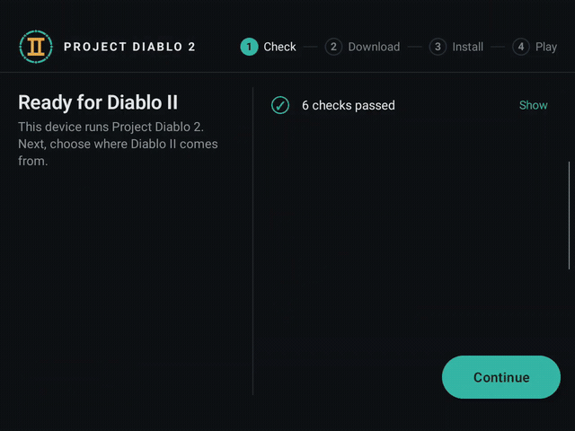
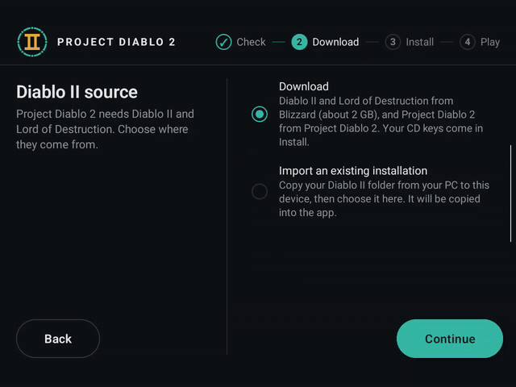
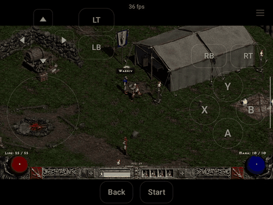
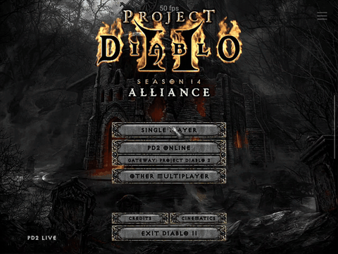
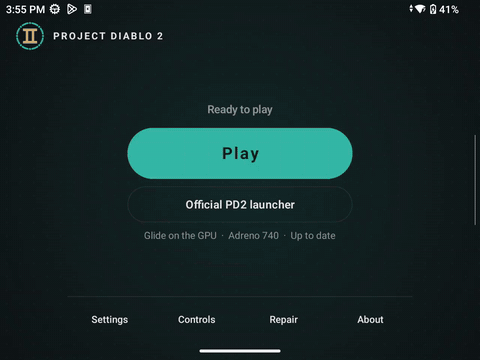
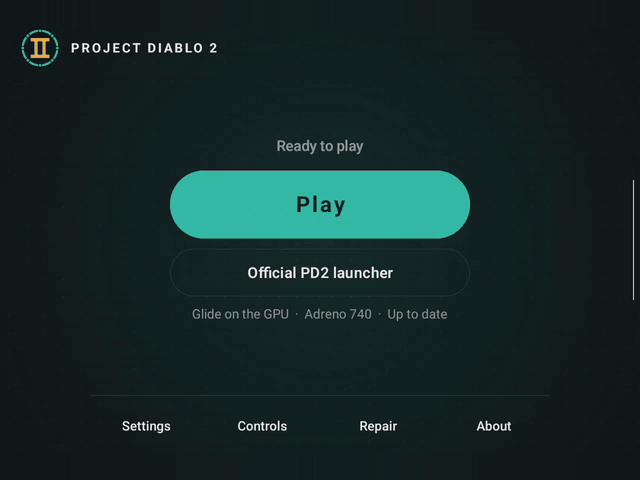

# PD2 Launcher for Android

> **Unofficial.** PD2 Launcher is a community-made tool. It is not affiliated with or endorsed by the Project Diablo 2 team or Blizzard Entertainment.

Play [Project Diablo 2](https://www.projectdiablo2.com/) on your Android phone or handheld. The app runs the official PD2 launcher, keeps the game up to date, lets you manage your loot filters, and lets you play online.

## Features

- **Install with no PC:** **Fast download**, our own installer, downloads Diablo II and Lord of Destruction directly from Blizzard's CDN in minutes, then installs Project Diablo 2. Or use the files you have.
- **Online and single player.**
- **The official PD2 launcher:** for loot filters and its other settings.
- **Game updates:** **Play** finds a new PD2 version and asks you first.
- **Controllers:** Bluetooth and USB, with a button layout for each controller and a mouse mode.
- **Touch:** a trackpad pointer or direct touch, and on-screen controls that you can arrange.
- **Mouse and keyboard:** USB or Bluetooth, as on a PC.
- **In-game menu:** settings while you play. The game does not pause.
- **Frame rate and display:** frame rate, game resolution, fit to screen or center.
- **Low sound delay.**
- **Your files:** in Android's Files app. **Save sync** keeps your characters in a folder for a sync app, such as Syncthing.
- **App updates:** the app updates itself and keeps your game, characters and settings.
- **On your device:** no root and no PC streaming. The game uses your device's own graphics chip.

## See it run

https://github.com/user-attachments/assets/f294dbf7-d77c-46bf-a42d-584854420aa3

  
  

<b>Left:</b> install from Blizzard's installers on the device, with no PC (sped up). <b>Right:</b> import a game folder that you copied from your PC.

  
  

<b>Left:</b> walk with the on-screen controls, a virtual controller. <b>Right:</b> the in-game menu's <b>Controls</b> screen shows what each controller button does. <b>Edit on-screen layout</b> moves, resizes and fades each on-screen control, and adds buttons for keys.

  
  

<b>Left:</b> <b>Settings</b>: the game resolution, the display, the frame rate, the graphics profile, and the options for the app and the controller. <b>Right:</b> for a problem report, <b>Share logs</b> sends the app's logs as one file, and <b>Save logs</b> saves that file on your device.

## What your device needs

- An ARM64 device with Android 11 or later, using 4 KB memory pages (almost every phone and handheld does).
- A supported GPU:
  - Qualcomm Adreno 6xx, 7xx or 8xx (Snapdragon devices), or
  - Arm Mali of the v10 to v13 architectures on Arm's CSF kernel driver, such as the Mali-G310, G610, G710, G615, G715, G720 and G725.
- Free storage for the app and its runtime (about 0.6 GB), the game (about 3 GB), and the installer downloads (about 2.7 GB). The downloads are needed only during the installation: once the game works, the app offers to remove them.

The app checks all of this when it first starts and says what is missing. A GPU of a supported family that the bundled graphics driver does not know gets a warning instead: the game may still run. The check does not look at the kernel version.

## Supported graphics chips

### Built-in driver

The app has its own graphics driver from Mesa: Turnip for Adreno GPUs and PanVK for Mali GPUs. This driver knows the GPUs below. For a different GPU of these families, the Check screen shows a warning, and the game may still run.

| Family | GPUs |
|---|---|
| Adreno 6xx | 605, 608, 610, 612, 613, 615, 616, 618, 619, 620, 621, 623, 630, 640, 642L, 643, 644, 650, 660, 663, 680, 690 |
| Adreno 7xx | 702, 704, 710, 720, 722, 725, 730, 735, 740, 750, 753, A32 |
| Adreno 8xx | 810, 829, 830, 840 |
| Mali (v10 to v13) | G310, G610, G710, G615, G715, G720, G725, Immortalis-G715, Immortalis-G720, Immortalis-G925 |

The Check screen shows some of these GPUs with a different name: the Adreno 642L and 643 as Adreno 635, and an Immortalis GPU as the Mali GPU of the same type (the Immortalis-G925 as Mali-G725).

### Phone's own driver

Not in this version. The game uses only the built-in driver.

## Install

Download the APK from the [releases page](https://github.com/Pocketward/pd2-launcher-android/releases) and open it on your device. Android asks once to allow installs from the app you opened it with (your browser or file manager). The app is not on Google Play. Later versions come through the app itself: see [How do updates work?](docs/FAQ.md#how-do-updates-work).

You need your Diablo II and Lord of Destruction CD keys (two different keys of 26 letters and numbers) and an internet connection; the app downloads Diablo II and Lord of Destruction from Blizzard and Project Diablo 2's files from their official sources. If you already have Diablo II and Lord of Destruction installed on a PC, of any version, you can copy that folder to the device instead and need no CD keys: the app uses it as it is when the Diablo II and Lord of Destruction files are in it.

## Using it

The app walks you through four steps:

1. **Check:** your device, notifications and battery settings (both optional, but without them Android may stop the game while the app is in the background), and the game's support files, which the app unpacks once.
2. **Download:** pick **Fast download** (the default: Diablo II and Lord of Destruction straight from Blizzard, about 2 GB), **Blizzard's installers** (Blizzard's own installers run in the app; this takes longer) or **Use files you have** (your Diablo II folder copied from a PC; the app makes its own copy). For a download, the app gets the installers ready (Blizzard's two small downloaders and Project Diablo 2's files) and asks for your CD keys at once.
3. **Install:** enter your CD keys and accept Blizzard's terms, also while the installers get ready. The app checks the keys first: a red line under a key says what is wrong with it. When you tap **Agree and install**, the game download starts as soon as the installers are ready. With **Fast download**, our own installer downloads both games directly from Blizzard's CDN, with up to 64 connections at the same time, and installs them, much faster than Blizzard's installers: a few minutes on our test phones. With **Blizzard's installers**, the app runs Blizzard's installers unattended, with a small live view of their windows; expect half an hour or more. Then the app installs Project Diablo 2. **Stop** pauses safely and **Resume** continues where it stopped. The app never saves your CD keys: it uses them only for the install. The installed game keeps them, as Diablo II requires; **Repair → Start over** removes the installed game and with it the keys.
4. **Play:** first checks for a new version of Project Diablo 2, then starts the game. When there is a new version, Play asks you: **Update** installs it, then the game starts; **Cancel** keeps your version, and Play then offers **Update** and **Play without updating**. When there is no network or the check fails, the game starts without the check. **Official PD2 launcher** opens Project Diablo 2's own launcher, for example to manage loot filters. When you start the game from it, the launcher closes and the game continues to run. When the official launcher has updated the game files, Play asks you to check them once with **Check files**.

**Use files you have** always keeps the Project Diablo 2 in your folder as it is, of any version or with a mod: the import does not update it. Before the copy, the app checks the important files: Game.exe, Diablo II.exe, d2data.mpq, d2char.mpq, d2sfx.mpq and d2exp.mpq, and in the ProjectD2 folder Game.exe, ProjectDiablo.dll and PD2Launcher.exe. If a file is missing, the app lists it and the import does not start. If you choose **Use files you have** after a download started, the app removes the downloaded files when it accepts your folder. The app checks for a new version of Project Diablo 2 only when you press **Play**, and you then choose **Update** or **Cancel**.

For PD2 mods and older versions of Project Diablo 2: import your version, turn **Check for game updates** off in **Settings → Game**, and play. The setting is on by default. When it is off:

- Play starts the game as it is installed. The app does not check for new versions of Project Diablo 2 and does not offer **Update**.
- Play asks for **Check files** only when Game.exe changes or a game file is missing. **Check files** then keeps the files that you have. It cannot bring back a missing file: for that, turn the setting on.
- The official PD2 launcher can still update the game when you open it. The app keeps the files that it leaves.

To get the newest version again, turn the setting on: when there is a newer version, Play then offers **Update**. This setting does not change the updates of the app itself.

In the game:

- **Touch:** with **Trackpad** (the default), your finger moves the pointer as on a laptop's trackpad. Tap to click where the pointer is. To hold the left button, tap, then touch again at once and move. A two-finger tap is a right click. **Pointer speed** sets how far the pointer moves. With **Direct**, the pointer goes where you touch: tap to click, long press for a right click, and drag to hold the left button. Choose at **Touch** in the in-game **Controls** screen or in **Settings → Controller**. On-screen controls (a virtual controller) show while no controller is connected; switch them with **On-screen controls** in the in-game menu and arrange them with **Edit on-screen layout** in its Controls screen.
- **Controller, mouse and keyboard:** see [How do I use a controller?](docs/FAQ.md#how-do-i-use-a-controller) and [Can I use a mouse and a keyboard?](docs/FAQ.md#can-i-use-a-mouse-and-a-keyboard) in the FAQ.
- **In-game menu:** the floating button, Android's Back gesture, or the controller chord opens a menu on the right edge, without pausing the game. **L1** and **R1** step through **Quick**, **Controls** and **Settings**. While the menu is open, the game runs at its background frame rate, and the on-screen controls show dimmed and do not work (with **Slower game in the background** on). **Quick:** On-screen controls, FPS counter, Display, Keyboard and Frame rate. **Settings:** Slower game in the background, Sound in background, Keep the screen on during play, and Stop game. The gamepad icon opens **Controls**, which keeps the menu's side bar: pad mode and mouse mode (**Use mouse mode** or **Use pad mode** switches the controller, as Select + Start does), what each button does (press a button's row to change it), the pointer speed and the on-screen layout.
- **Settings:** the renderer (Glide, recommended, or DirectDraw), the game resolution (the game's own 1068 × 600 by default, or a custom size; on a smaller screen, its full size), the display (Fit to screen: the game's menus and the game as large as the screen allows; or Center: each game pixel as one screen pixel; also in the in-game menu), the graphics profile (Default or Performance), Skip to Battle.net, sound in the background, Check for game updates, the controller, Save sync and storage.

The game keeps running when you switch apps; a notification shows while it does. The official PD2 launcher, a download and an install also keep running, with the same notification. Its **Close** button stops them safely (an install pauses, and **Resume** continues it later) and closes the app. When nothing runs, there is no notification: the app stops in the background 10 seconds after you leave it, and at once when you close it or swipe it away.

## Your files

Your characters are kept apart from the installation, so an update or a new install of Project Diablo 2 never touches them. The game folder, with your characters and loot filter, shows in Android's Files app under **PD2 Launcher**: **Open in Files** in **Settings → App → Game files** opens it. You can put files of all types in the game folder, for example the .dll files of a mod. These files run with the game: put only files that you trust there, and give the game folder to another app only if you trust that app.

For backups, **Save sync** and uninstalls, see [Where are the game folder and my characters?](docs/FAQ.md#where-are-the-game-folder-and-my-characters) and [How do I sync my characters with Syncthing?](docs/FAQ.md#how-do-i-sync-my-characters-with-syncthing) in the FAQ.

## Problems

The [FAQ](docs/FAQ.md) answers the common problems. For a different problem, open an [issue](https://github.com/Pocketward/pd2-launcher-android/issues) and attach the app's logs: see [How do I send logs?](docs/FAQ.md#how-do-i-send-logs).

## How it works

The app sets up Diablo II, Lord of Destruction and Project Diablo 2 the same way the [desktop PD2 Launcher](https://github.com/Pocketward/pd2-launcher) does on Linux, and runs the game on your device's GPU. It needs no Linux container app.

The game runs in Wine 11.0 built for ARM64. Wine runs natively on your device's CPU; Box64's WowBox64 translates only the 32-bit x86 code of the game, the installers and Project Diablo 2's own launcher.

## Building from source

This repository holds the Android app (`app/`), the Linux programs and patches it carries (`userland/`) and the game's runtime (`runtime/`: Wine, Box64's WowBox64, the prefix template and .NET). The build runs in pinned containers (Podman or Docker); the prefix template and the engine's identity check also need qemu-user for ARM64 on the host. The build compiles the engine, the [desktop PD2 Launcher](https://github.com/Pocketward/pd2-launcher) without its window, from the sources that [`engine.lock`](engine.lock) pins, and fetches Wine, Box64, glibc, Mesa, the X server, the Debian packages and .NET at pinned versions, with the patches in `userland/` and `runtime/` applied on top. See [`docs/BUILDING.md`](docs/BUILDING.md) for the steps and [`docs/ARCHITECTURE.md`](docs/ARCHITECTURE.md) for how the pieces fit together.

## Disclaimer

Project Diablo 2, Diablo, and Blizzard are names of their respective owners. PD2 Launcher contains none of their software or data: it downloads Blizzard's installers and Project Diablo 2's files from their official sources on your device.
