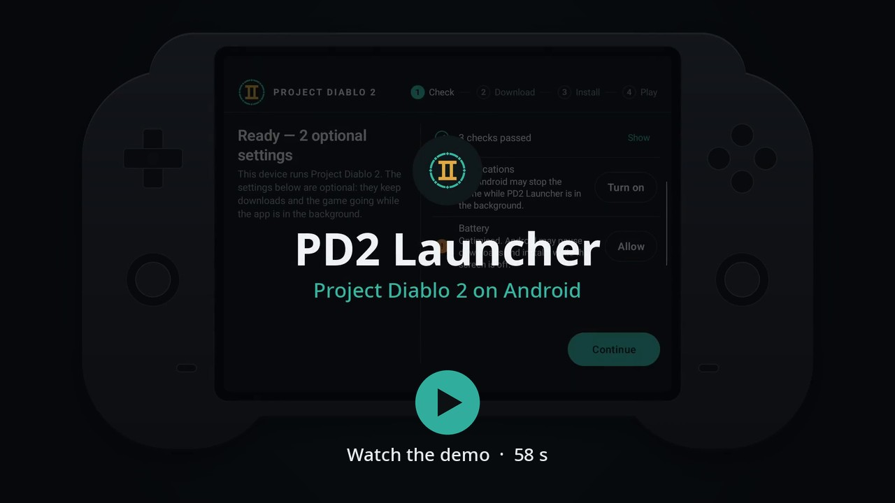
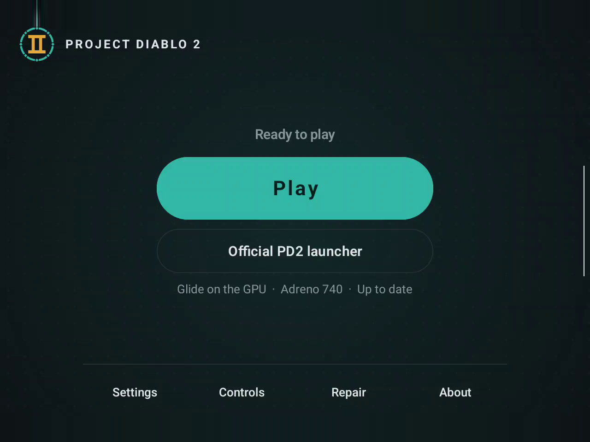
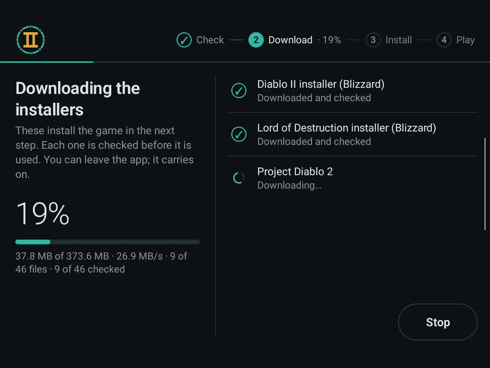
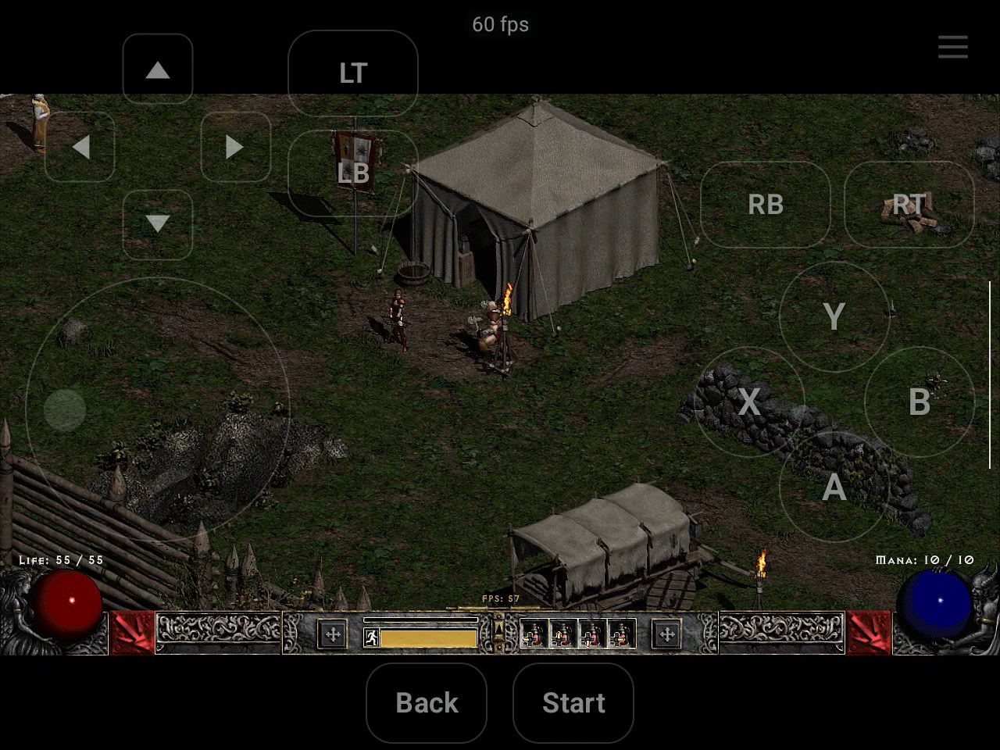
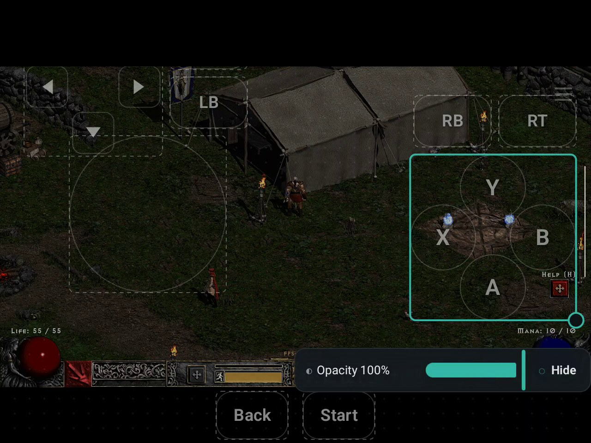
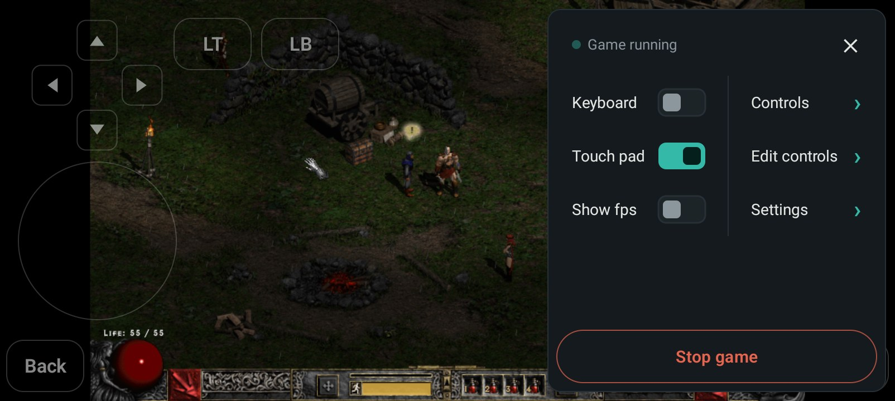
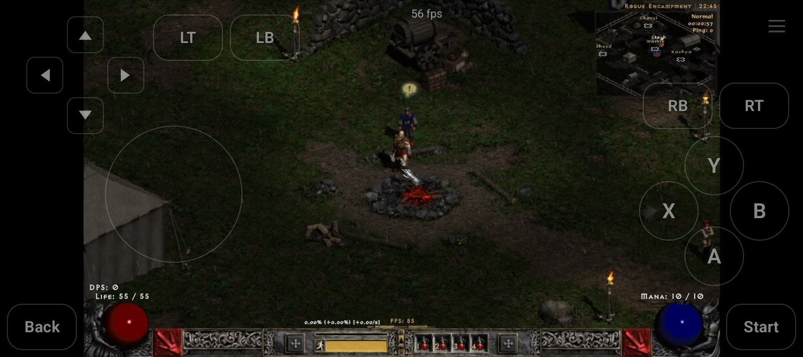

# PD2 Launcher for Android

> **Unofficial.** PD2 Launcher is a community-made tool. It is not affiliated with or endorsed by the Project Diablo 2 team or Blizzard Entertainment.

An Android app that installs [Project Diablo 2](https://www.projectdiablo2.com/) on your phone or handheld, keeps it up to date, and starts it with touch and controller controls. It sets up Diablo II, Lord of Destruction and Project Diablo 2 the same way the [desktop PD2 Launcher](https://github.com/Pocketward/pd2-launcher) does on Linux, and runs the game on your device's GPU. No root, no Linux container app, no PC streaming.

The game runs in Wine 11.0 built for ARM64. Wine runs natively on your device's CPU; Box64's WowBox64 translates only the 32-bit x86 code of the game, the installers and Project Diablo 2's own launcher.

## See it run

| | |
|:---:|:---:|
|  |  |
| **Play** starts the game. **Official PD2 launcher** opens Project Diablo 2's own launcher. | **Download** gets Blizzard's installers and Project Diablo 2, and checks each file. |
|  |  |
| The game with the on-screen controls, a virtual controller. | **Edit controls** moves, resizes and fades each control, and adds buttons for keys. |
|  |  |
| The in-game menu on a phone. The game does not pause. | The game on a phone with an Arm Mali GPU. |

## What your device needs

- An ARM64 device with Android 13 or later, using 4 KB memory pages (almost every phone and handheld does).
- A supported GPU:
  - Qualcomm Adreno 6xx, 7xx or 8xx (Snapdragon devices), or
  - Arm Mali of the v10 to v13 architectures on Arm's CSF kernel driver, such as the Mali-G310, G610, G615, G715, G720 and G725.
- Free storage for the app and its runtime (about 0.6 GB), the game (about 3 GB), and the installer downloads (about 2.6 GB). The downloads are needed only during the installation: once the game works, the app offers to remove them.

The app checks all of this when it first starts and says what is missing. A GPU of a supported family that the bundled graphics driver does not know gets a warning instead: the game may still run. The check does not look at the kernel version.

## Install

Download the APK from the [releases page](https://github.com/Pocketward/pd2-launcher-android/releases) and open it on your device. Android asks once to allow installs from the app you opened it with (your browser or file manager). The app is not on Google Play.

You need your Diablo II and Lord of Destruction CD keys (two different keys) and an internet connection; the app downloads Blizzard's official installers and Project Diablo 2's files from their official sources. If you already have Diablo II and Lord of Destruction 1.14b or 1.14d installed on a PC, you can copy that folder to the device instead and need no CD keys.

## Updates of this app

From version 0.3.0, the app looks for a new version of itself once a day, while **Settings → App → Look for new versions** is on. It is on by default. When a new version is out, Android shows one notification for it, and **About** shows it under **App updates**. The download starts only when you tap **Download**. On a network that can count data, for example mobile data, a note gives the size first. Android always asks you to confirm the update. The first time, you allow **Install unknown apps** for PD2 Launcher in Android's settings, and Android can restart the app when you do this. Your game, characters and settings stay. Nothing about app updates shows on **Play**. A version before 0.3.0 cannot update itself: install 0.3.0 over it by hand.

## Using it

The app walks you through four steps:

1. **Check:** your device, notifications and battery settings (both optional, but without them Android may stop the game while the app is in the background), and the game's support files, which the app unpacks once.
2. **Download:** pick **Download** (Diablo II and Lord of Destruction from Blizzard, about 2 GB) or **Import an existing installation** (your Diablo II folder copied from a PC; the app makes its own copy). The installers download and are checked.
3. **Install:** enter your CD keys and accept Blizzard's terms; the app then runs Blizzard's installers and Project Diablo 2's unattended, with a small live view of their windows. Expect half an hour or more. **Stop** pauses safely and **Resume** continues where it stopped. The app never saves your CD keys: it passes them to Blizzard's installer only. Blizzard's installer stores them in the installed game, as Diablo II requires; **Repair → Start over** removes the installed game and with it the keys.
4. **Play:** starts Project Diablo 2. When Project Diablo 2 has an update, the button offers **Update** first; you can also play without updating. **Official PD2 launcher** opens Project Diablo 2's own launcher, for example to manage loot filters. When the official launcher has updated the game files, Play asks you to check them once with **Check files**.

In the game:

- **Touch:** tap to click, long press and drag as with a mouse. On-screen controls (a virtual controller) show while no controller is connected; switch them with **Touch pad** in the in-game menu and arrange them with **Edit controls**.
- **Controller:** works as an Xbox controller. Press **Select + Start** (or **L3 + R3**, set in Controls) to switch to mouse mode for menus and typing; hold it to open the in-game menu. Every button can be rebound.
- **In-game menu:** the floating button, Android's Back gesture, or the controller chord opens a menu on the right edge, without pausing the game: Keyboard, Touch pad, Show fps, Controls, Edit controls, Settings and Stop game.
- **Settings:** the renderer (Glide, recommended, or DirectDraw), the game resolution (fewer lines run smoother; Automatic picks one for your GPU), the graphics profile (Default or Performance), Skip to Battle.net, sound in the background, the controller, and storage.

The game keeps running when you switch apps; a notification shows while it does.

## Your files

Characters are kept in the app's own storage, apart from the installation, so reinstalling or updating Project Diablo 2 never touches them. The game folder (with your characters and loot filter) appears in Android's Files app under **PD2 Launcher**, and **Settings → App → Game files** imports and exports files.

Uninstalling the app removes the installation. Android offers to keep the app's data; copy your characters out first if you want to be sure to keep them.

## Problems

Open an [issue](https://github.com/Pocketward/pd2-launcher-android/issues) with your device's model, Android version and GPU (the Check screen shows them) and what happened, and attach the app's logs: **Share logs** in **Settings → App**, or under the error on the Check, Download and Install screens (and on Install while it runs or is paused), makes one file to send; **Save logs** beside it saves that file on the device instead, for example in Downloads. It holds no CD keys, but it can show your character names and network addresses.

Common problems:

- **The download or install stops part way, for example at about 80%.** Tap **Try again**. The app keeps what is already downloaded and continues from there; a second try often finishes.
- **A download stops while the app is in the background, or the app asks you to check a connection that works.** Some phones cut off an app's network access, or stop it, while it is in the background, to save battery or data. In the phone's settings for PD2 Launcher, allow it to use the network in the background and set its battery use to no restrictions; the names of these settings are different on each phone. The Check screen's Connection row tells you when the phone blocks the app's network, and opens the app's settings.

## Building from source

This repository holds the Android app (`app/`), the Linux programs and patches it carries (`userland/`) and the game's runtime (`runtime/`: Wine, Box64's WowBox64, the prefix template and .NET). The build runs in pinned containers (Podman or Docker); the prefix template also needs qemu-user for ARM64 on the host. The build downloads the engine, the [desktop PD2 Launcher](https://github.com/Pocketward/pd2-launcher) release that [`engine.lock`](engine.lock) pins, and fetches Wine, Box64, glibc, Mesa, the X server, the Debian packages and .NET at pinned versions, with the patches in `userland/` and `runtime/` applied on top. See [`docs/BUILDING.md`](docs/BUILDING.md) for the steps and [`docs/ARCHITECTURE.md`](docs/ARCHITECTURE.md) for how the pieces fit together.

## Disclaimer

Project Diablo 2, Diablo, and Blizzard are names of their respective owners. PD2 Launcher contains none of their software or data: it downloads Blizzard's installers and Project Diablo 2's files from their official sources on your device.
